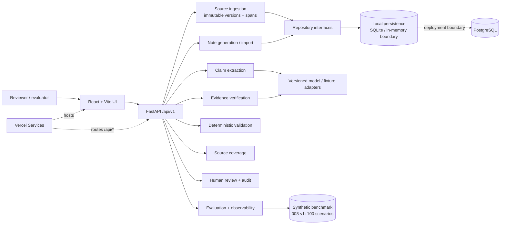
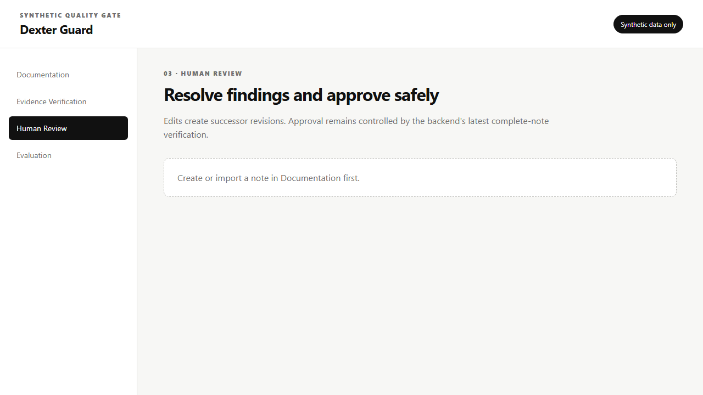

# Dexter Guard

Dexter Guard is an evidence-oriented reliability engine for synthetic German
nursing documentation. It helps a reviewer determine whether a candidate note
is faithful to its source transcript before the note is approved.

> Dexter Guard is a pre-approval quality gate, not an autonomous clinical
> decision-maker. The repository uses synthetic data only and does not claim
> clinical safety or regulatory certification.

## The problem

Nursing notes generated from transcripts can sound fluent while still changing
the meaning of the source. Common failures include:

- turning uncertainty into certainty;
- dropping negation or attribution, such as changing “the resident reports”
  into an observed fact;
- changing numbers, units, dates, or precision;
- omitting material observations;
- introducing unsupported clinical inferences; and
- approving a revised note against stale verification results.

These failures are difficult to catch with text similarity or a single model
confidence score. A trustworthy workflow needs immutable source versions,
exact evidence references, deterministic checks, explicit failure states, and a
human reviewer who remains in control of approval.

## Purpose

Dexter Guard provides the reliability layer around note generation or import:

1. preserve the submitted German transcript as an immutable, versioned source;
2. generate or import a candidate note with structured, source-linked facts;
3. verify claims against exact source spans;
4. run deterministic checks for numeric, unit, identity, span, and contract
   integrity;
5. measure source coverage and omissions;
6. let a human resolve findings, create successor revisions, and approve only a
   latest fully verified revision; and
7. record evaluation and audit evidence without logging transcript or model
   content unnecessarily.

## Architecture



The backend owns source identity, versioning, contracts, verification, review
policy, persistence, and evaluation metrics. The frontend displays those
backend results; it does not recalculate denominators or make approval
decisions. Evidence spans use zero-based, inclusive `start` and exclusive
`end` offsets against the exact stored source version.

## Implemented features

- **Immutable source ingestion:** accepts synthetic German (`de-DE`) transcripts,
  assigns source IDs and versions, preserves historical revisions, and resolves
  exact source spans.
- **Candidate note workflow:** supports generated and externally imported draft
  notes with structured facts, provenance, source anchors, and revision
  metadata.
- **Evidence verification:** classifies findings as `SUPPORTED`, `UNSUPPORTED`,
  `CONTRADICTED`, or `UNCERTAIN`, validates quotations and spans, and preserves
  typed provider and integrity failures.
- **Offline semantic verification:** provides a deterministic local fallback for
  German paraphrases and symptom-level negation. Mixed statements such as
  `Schmerzen, aber keine Übelkeit` are evaluated per symptom rather than using
  one sentence-wide polarity.
- **Deterministic validation:** checks numeric values, units, precision,
  required references, source versions, and contract invariants without needing
  an LLM or network access.
- **Source coverage:** compares documented material against annotated expected
  facts and reports omissions separately from runtime extraction counts.
- **Human review and audit:** supports editable successor revisions, finding
  acknowledgement/dispute, explicit correction decisions, full-note
  verification, approval eligibility, rejection rationale, and persisted audit
  history.
- **Resident attribution safeguards:** supports an explicit synthetic
  resident-alias mapping, flags cross-resident or ambiguous claims, and blocks
  approval until uncertain attribution is clarified.
- **Evaluation and observability:** runs versioned synthetic benchmark cases,
  validates split integrity, matches findings to expected errors, records raw
  counts and denominators, supports paired comparisons, and exposes saved-run
  inspection through the UI.
- **Web application:** includes Documentation, Evidence Verification, Human
  Review, and Evaluation workspaces with typed API access and generated
  OpenAPI client types. Documentation & Verification uses one segmented-toggle
  workspace with two mutually exclusive modes: **Generate and verify** creates
  a note and verifies it; **Verify existing note** checks caregiver-supplied
  note text without generating a replacement. Saved examples can populate
  either workflow.
- **Frontend safeguards:** validates resident IDs, transcripts, and note text
  against backend-compatible rules before submission; shows field-specific
  errors; disables invalid submissions; preserves transcript state through
  Human Review navigation; and supports mobile and tablet widths without
  horizontal page scrolling.
- **Verification status messaging:** distinguishes “No findings were recorded”
  from “All recorded findings have been resolved or adjudicated.” Success is
  shown only after verification completes and `approvalEligible` is true;
  loading, failed, unresolved, and ineligible states remain blocking.
- **Deployment topology:** `vercel.json` routes `/api/*` to FastAPI and all
  other paths to the Vite application through Vercel Services.

## Review interface

The implemented review route keeps approval fail-closed: unsaved edits are not
verified, saving creates an immutable successor revision, and approval requires
a latest complete-note verification for the current revision.



The screenshot is a local render of `/review` captured from the Vite app. It
shows the safe empty state before a note is created in Documentation; a
populated session adds the editable note, findings, suggestions, approval
eligibility, and audit history panels.

## Local installation

### Prerequisites

- Python 3.11 or newer
- [`uv`](https://docs.astral.sh/uv/)
- Node.js and npm
- Playwright Chromium for browser end-to-end tests

### Install dependencies

From the repository root:

```powershell
uv sync --group dev
```

In a second terminal:

```powershell
cd frontend
npm ci
```

### Configure environment

Use `backend/.env.example` and `frontend/.env.example` as the variable-name
references. For local frontend development:

```text
VITE_API_BASE_URL=/api/v1
```

Only browser-safe values may use the `VITE_` prefix. Database URLs, LLM keys,
provider configuration, and other server-only secrets must not be exposed with
`VITE_` or committed to Git.

### Run locally

Start the FastAPI service from the repository root:

```powershell
uv run uvicorn app.main:app --env-file backend/.env --reload --port 8000
```

Start the Vite frontend from `frontend/`:

```powershell
npm run dev
```

Open the URL printed by Vite, then use the Documentation workspace to submit a
synthetic transcript and create or import a candidate note.

### Test and quality checks

Backend, from the repository root:

```powershell
uv run pytest
```

Frontend, from `frontend/`:

```powershell
npm test
npm run lint
npm run check
npm run test:e2e
```

Regenerate typed API bindings after an OpenAPI contract change:

```powershell
npm run api:generate
```

Focused regression checks for the current verification and evaluation paths:

```powershell
uv run pytest backend/tests/evaluation
uv run pytest backend/tests/evidence_verification backend/tests/app/test_offline_semantic_evidence_provider.py
cd frontend
npm test -- --run tests/verification-results.test.tsx tests/documentation-two-mode-workspace.test.tsx
```

The current focused results are 32 evaluation tests passed, 75 evidence and
offline-provider tests passed, and 14 frontend verification/documentation tests
passed. These are engineering regression results, not clinical validation.

## Sample input and output

The following is a synthetic example of the source-ingestion boundary.

### Input

```json
{
  "resident_test_id": "synthetic-resident-demo",
  "language": "de-DE",
  "transcript_text": "Die Bewohnerin berichtet über leichten Schwindel. Die Pflegekraft beobachtet keinen Sturz."
}
```

### Output

```json
{
  "source_id": "source-01HZX7Q2K7",
  "source_version": 1,
  "resident_test_id": "synthetic-resident-demo",
  "language": "de-DE",
  "transcript_text": "Die Bewohnerin berichtet über leichten Schwindel. Die Pflegekraft beobachtet keinen Sturz.",
  "created_at": "2026-10-14T10:00:00Z"
}
```

The returned `(source_id, source_version)` is the immutable identity used by
downstream notes, claims, findings, and audit records. A span such as
`{"source_id":"source-01HZX7Q2K7","source_version":1,"start":24,"end":44}`
must resolve against that exact stored transcript; it cannot silently resolve
against a later revision.

## Evaluation results

The repository contains versioned synthetic evaluation artifacts. These results
are engineering evidence, not clinical validation.

| Artifact | Dataset / scope | Result | Interpretation |
| --- | --- | ---: | --- |
| Spec 008 held-out gate | 100 scenarios total; 60 development, 20 validation, 20 held-out | Critical-error recall **5/5 (100%)** | Passes the approved held-out target of ≥95% for the deterministic saved-fixture run. |
| Spec 004 development report | 11 semantic claims | Exact classification **11/11 (100%)** | Deterministic fixture verifier; not held-out and not a production quality claim. |
| Spec 004 development report | 6 eligible critical cases | Critical-error recall **6/6 (100%)** | All critical fixture cases were detected. |
| Spec 004 development report | 2 predicted supported claims | Supported-claim false-positive rate **0/2 (0%)** | No false positive among supported predictions in the fixture. |
| Spec 004 development report | 8 findings requiring grounding | Evidence grounding validity **8/8 (100%)** | All counted findings had valid source grounding. |
| Spec 006 versioned handoff | 9 applicable annotated facts | Benchmark completeness **3/9 (33.33%)** | Demonstrates why completeness must remain a separate metric from extraction runtime counts. |
| Spec 006 versioned handoff | 6 annotated omissions | Omission detection recall **6/6 (100%)** | All annotated omissions were flagged in that fixture. |
| Spec 006 versioned handoff | 3 reviewed non-omissions | False omission warning rate **0/3 (0%)** | No false omission warnings in that fixture. |

The Spec 008 benchmark manifest is
[`data/evaluation/008-v1/manifest.json`](data/evaluation/008-v1/manifest.json).
The detailed source reports are
[`spec004-development-evaluation-v1.json`](specs/004-evidence-verification/evaluation/spec004-development-evaluation-v1.json)
and
[`spec006-development-evaluation-v1.json`](specs/006-source-coverage/evaluation/spec006-development-evaluation-v1.json).

Claim-classification accuracy is calculated from actual verifier predictions,
not from successful test execution or copied expected answers. Correct,
incorrect, missing, and duplicate predictions are counted at claim level; a
10/10, 6/10, and 0/10 prediction set reports 100%, 60%, and 0% accuracy.
Finding-level false positives, duplicate warnings, and target-linked
misclassifications are scored separately from classification accuracy.

Additional engineering evidence recorded in the Spec 008 convergence notes:

- the full repository suite reported **338 passed** on 2026-10-13;
- the accepted benchmark is synthetic German data only;
- cost was `UNAVAILABLE` for the saved fixture provider because no token or
  pricing source was configured; and
- reviewer-workload metrics were not available unless supplied by an observed
  review run.

Only critical-error recall has an approved numerical release target. Other
metrics are reported for inspection and regression analysis rather than being
given invented pass/fail thresholds.

## Engineering trade-offs

| Decision | Benefit | Cost / trade-off |
| --- | --- | --- |
| Exact source spans instead of copied evidence text | Keeps every finding anchored to authoritative source bytes/text and a version | Requires careful offset, Unicode, revision, and quotation validation. |
| Deterministic rules plus isolated model adapters | Makes numeric, provenance, schema, and failure behavior reproducible | More interfaces and fixtures are required; semantic interpretation remains provider-dependent. |
| Human approval gate instead of automatic approval | Keeps clinical-significant decisions with an authorized reviewer and fails closed on stale or incomplete verification | Adds review time and prevents fully unattended throughput. |
| Synthetic benchmark and saved fixture provider | Protects privacy and makes CI repeatable without network access | Results do not establish clinical safety or predict live-provider performance. |
| Repository interfaces with local persistence | Enables fast deterministic tests and a future PostgreSQL implementation without changing contracts | Deployment still needs durable PostgreSQL, pooling, migrations, backups, and retention policy. |
| React/Vite frontend with FastAPI Services deployment | Gives one coherent local workflow and one-URL deployment topology | Frontend, backend, contract generation, and deployment gates must stay compatible. |

## Known limitations

- The proof of concept is synthetic-only. It must not be used with real patient
  data or interpreted as a clinical safety validation.
- A production LLM/provider configuration is not part of the committed
  evaluation evidence. The development reports use deterministic fixture
  adapters behind structured interfaces.
- Candidate-evidence discovery is not a separate retrieval subsystem; short
  synthetic transcripts are supplied in full to the evaluation pipeline.
- Production authentication, authorization, retention, deletion, export
  controls, encryption, and multi-user access management remain future work.
- Deployed immutable sources, notes, runs, decisions, and audit history require
  PostgreSQL configuration; local setup is not a production persistence model.
- Observed reviewer workload, live-provider cost, and live model variability are
  not represented in the saved fixture metrics.
- The offline semantic verifier intentionally uses a small deterministic German
  vocabulary and clause-local scope rules. It is a local fallback, not a
  comprehensive German language-understanding system.
- The repository’s convergence notes preserve reviewer-owned and deployment
  gates; passing tests alone does not imply overall product or release
  readiness.

## Future improvements

- Run the full benchmark with approved, versioned providers, prompts, models,
  pricing, and timeout/retry configuration, then publish paired raw-count
  reports with confidence intervals and failure examples.
- Add a dedicated evidence-retrieval layer for longer transcripts while keeping
  source-span validation authoritative.
- Complete the production persistence boundary with PostgreSQL migrations,
  serverless-safe pooling, backups, retention, access control, and tamper-evident
  audit storage.
- Add authentication and authorization for reviewer and evaluator actions.
- Expand observed human-review metrics, including time-to-resolution, burden,
  disagreement, correction acceptance, and final-note quality.
- Improve the review workspace with richer source/draft/finding side-by-side
  navigation, persistent case drill-down, and populated walkthrough assets.
- Add independent requirements review and deployment smoke evidence to the
  convergence record before making a release claim.

## Project documentation

- [Constitution](.specify/memory/constitution.md)
- [Architecture](docs/architecture.md)
- [Spec 009 quickstart](specs/009-ui-implementation/quickstart.md)
- [Spec 008 evaluation procedure](specs/008-evaluation-and-observability/converge.md)
- [Vercel deployment decision](docs/deployment/spec-009-vercel-decision.md)
- [Evidence-verification operations guide](docs/operations/evidence-verification.md)

## License

See [LICENSE](LICENSE).

