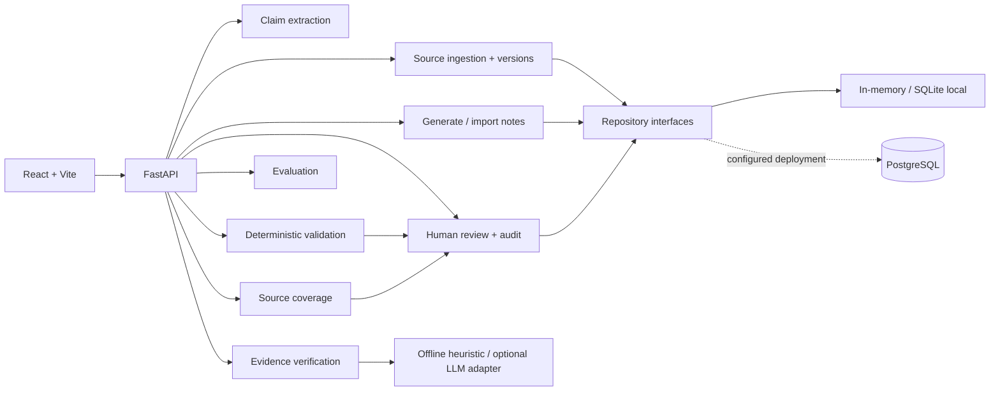

# Dexter Guard

An evidence-oriented reliability layer for synthetic German nursing documentation. Dexter Guard checks whether claims in a candidate note are supported by an immutable source transcript and keeps approval with a human reviewer.

> A portfolio prototype and pre-approval quality gate—not a clinical decision-maker. It uses synthetic data only and makes no claim of clinical safety, certification, or production readiness.

## 1. Project overview and problem

Fluent notes can still alter source meaning: changing a measurement, dropping negation or attribution, omitting an observation, or adding an unsupported fact. Dexter Guard combines evidence-linked claim verification with deterministic integrity checks and a fail-closed human review workflow.

The goal is to make verification outcomes inspectable: reviewers can trace findings to source spans, resolve or adjudicate issues, revise a note, and approve only an eligible current revision.

## 2. Live demo and screenshots

- **Live demo:** Not currently deployed. Run the local demo below.
- **GitHub repository:** [mmaazkhanhere/dexter-guard](https://github.com/mmaazkhanhere/dexter-guard)

> **Screenshot placeholder:** A populated capture showing an incorrect nursing claim, its source evidence, and the verification warning is not available in this repository. Add a real application capture here when available; no screenshot is fabricated.

The existing [review-workspace image](docs/assets/review-workspace.png) shows an empty state, so it is not used as the product demonstration.

**Incorrect measurement example.** Source: “Um 14:00 Uhr betrug die Temperatur 37,4 Grad Celsius.” Candidate note: “Um 14:00 Uhr betrug die Temperatur 38,4 Grad Celsius.” The verifier can flag the changed value and link the finding to source evidence. This illustrates error detection only; it does not show that a corrected final note is better.

## 3. Key capabilities

- Import German transcripts as immutable, versioned sources and resolve exact evidence spans.
- Generate or verify an existing candidate note while preserving structured claims and provenance.
- Combine semantic evidence findings with deterministic checks for values, units, spans, versions, and contract integrity.
- Report source coverage and potential omissions separately from claim verification.
- Support note revisions, finding adjudication, explicit approval decisions, and audit history.
- Run versioned synthetic evaluations with raw counts, denominators, failure accounting, and reproducible adapters.
- Keep approval unavailable while a verified note has unsaved edits; saving creates a new revision that must be verified again.
- Refresh audit history after every auditable review action, including saves, verification, finding decisions, approval, and rejection.
- Provide a founder-guided synthetic demo that works without visitor-supplied API keys when the configured provider is unavailable.
- Preload reproducible evaluation evidence and allow visitors to inspect individual cases: transcript, generated note, expected and actual findings, evidence spans, disagreement labels, benchmark version, and verifier metadata.

## 4. Technical architecture



The backend owns verification, persistence boundaries, metrics, and approval eligibility; the frontend presents those outcomes. Source identity is `(source_id, source_version)`. Spans use zero-based, inclusive-start/exclusive-end offsets against that exact version. The default semantic verifier is a local heuristic; an LLM verifier can be configured separately. Neither replaces deterministic validation or human approval.

## 5. Evaluation results

These synthetic engineering measurements are not clinical validation. The 30-case curated result below is a fresh run of the actual offline verifier and is presented separately from saved-fixture replay.

**Curated actual-verifier experiment**

- Dataset: `synthetic-german-nursing-curated-heldout`, version `008-curated-v1`, 30 cases; content hash `11860b196febcf69c21e887a5a02fea4401e7cc4be4b280e19eca07dba6066e6`.
- Evaluation adapter: `ReliabilityEngineEvaluationAdapter` (also exposed as `RealEvaluationAdapter`); the same source/note inputs were used in each arm, with expected annotations withheld from the verifier.
- Verifier: `OfflineSemanticEvidenceProvider`, `offline-semantic-v1`, with heuristic claim extraction; **not a hosted LLM** and no network/provider call.
- Configuration: paired baseline `reliability_enabled=false` versus validated `reliability_enabled=true`; `LIVE` execution mode, `HELD_OUT` split, 30 successful cases, 24 critical annotated errors. Latency is local and run-dependent.

| Measure | Baseline: reliability off | Validated: offline verifier |
| --- | ---: | ---: |
| Correctly matched errors | 0 / 24 | 9 / 24 |
| Missed errors | 24 / 24 | 15 / 24 |
| False-positive findings | 0 | 21 |
| Critical-error recall (Wilson 95% CI) | 0 / 24 = 0%; [0.000, 0.138] | 9 / 24 = 37.5%; [0.212, 0.573] |
| Actionable warnings per note | 0 / 30 = 0.000 | 28 / 30 = 0.933 |
| Verification latency, p50 / p95 / mean | 2.49 / 3.66 / 2.85 ms (n=30) | 14.28 / 18.49 / 14.35 ms (n=30) |

Strict matching matters: 12 predictions were linked to an annotated error but had an incorrect classification; three annotated errors had no valid matching finding. The validated arm’s 21 false positives comprise those 12 target-linked misclassifications, four unmatched warnings, and five duplicate predictions. There were no failed cases. A “correct match” is an exact finding-to-target match, not a claim that the final note is correct.

Examples from the measured validated run:

- **Detected:** `curated-numeric-temperatur` — source 37,4 °C versus note 38,4 °C; a `CONTRADICTED/OTHER` finding matched the expected error and source span.
- **Missed:** `curated-omission-abfuehrmittel` — the expected missing-fact finding was not emitted; an unrelated claim was classified as `DISTORTED`.
- **False positive / misclassification:** `curated-negation-schwindel` — a contradiction was emitted as `ATTRIBUTION` rather than expected `NEGATION`, so strict scoring records a mismatch and missed exact target.

**Saved regression fixtures (separate result)**

Dataset `008-v1` contains 100 saved scenarios (60 development, 20 validation, 20 held-out). A fresh held-out replay of 20 cases using `DeterministicFixtureAdapter` produced 14 / 14 matched fixture findings, 0 false positives, 0 missed errors, and 5 / 5 critical recall (100%; Wilson 95% CI [0.566, 1.000]). This is **fixture evidence only, not verifier accuracy**.

To measure the configured verifier, run the live evaluation with the same server-side `VERIFICATION_LLM_*` (or shared `LLM_*`) settings used by the demo:

```powershell
uv run python -m evaluation.cli --split HELD_OUT --database data/evaluation-live.sqlite3 --idempotency-key live-heldout-v1
```

The command fails closed when no verifier is configured; it never substitutes the offline pipeline. The JSON report labels the result `LIVE_MODEL` and includes exact claim classifications, critical recall, false positives, missed cases, latency, token usage, provider failures, and estimated cost when pricing variables are configured. Fixture and live-model results must not be combined or interpreted interchangeably.

The curated annotations are synthetic and marked pending; the sample is small. Results measure automated finding behavior, not improved final-note quality, caregiver workload, or reviewer benefit. The runner and dataset manifest are available in [the curated benchmark tests](backend/tests/evaluation/test_curated_benchmark.py) and [the 100-case manifest](data/evaluation/008-v1/manifest.json). Reproduce the paired curated run with:

```powershell
uv run pytest backend/tests/evaluation/test_curated_benchmark.py -k "paired or actual_verifier"
```

The test reruns the evaluator; no immutable machine-specific latency report is committed, so latency values can vary between runs.

## 6. Key engineering decisions and trade-offs

| Decision | Why it helps | Trade-off |
| --- | --- | --- |
| Separate generation from verification | A fluent generator should not certify its own output; an independent verifier can challenge each claim. | Adds latency and overlapping providers can still make correlated errors. |
| LLM semantics plus deterministic validation | Semantic checks can interpret paraphrases; deterministic rules provide predictable checks for numbers, spans, versions, and schemas. | The offline heuristic has limited language coverage; LLM output can vary or fail. |
| Structured outputs and claim-level evidence | Makes findings inspectable and traceable to source evidence instead of relying on a note-level score. | Claim extraction and strict matching can miss or misclassify valid evidence. |
| Immutable source versions and note revisions | Prevents evidence from silently drifting when a transcript or note changes. | Requires explicit version and stale-result handling. |
| Human-in-the-loop approval | Keeps approval with an authorized person; verification completion is not documentation correctness. | Human review remains necessary and adds workflow effort. |
| Versioned synthetic data and reproducible evaluation | Enables repeatable local tests without patient data or a hosted model. | Small synthetic results do not establish performance on real or broader language data. |

## 7. Quickstart

Prerequisites: Python 3.11+, [uv](https://docs.astral.sh/uv/), Node.js, and npm.

From a fresh clone, at the repository root:

```powershell
uv sync --group dev
Copy-Item backend/.env.example backend/.env
Copy-Item frontend/.env.example frontend/.env
Set-Location frontend
npm ci
```

The example frontend configuration uses `VITE_API_BASE_URL=/api/v1`. Keep provider keys and database URLs server-side; never put secrets in `VITE_*` variables. In one terminal from the repository root, start the API:

```powershell
uv run uvicorn app.main:app --env-file backend/.env --reload --port 8000
```

In another terminal:

```powershell
Set-Location frontend
npm run dev
```

Open the URL printed by Vite (normally `http://localhost:5173`). The **Verify Existing Note** workflow runs with the offline verifier and needs no LLM API key:

1. Open Documentation & Verification and choose **Verify existing note**.
2. Enter resident ID `synthetic-resident-demo`.
3. Paste source: `Um 14:00 Uhr betrug die Temperatur 37,4 Grad Celsius.`
4. Paste candidate note: `Um 14:00 Uhr betrug die Temperatur 38,4 Grad Celsius.`
5. Run verification and inspect the warning and linked source evidence.

The **Founder Demo** walkthrough is also available from the application navigation. It uses synthetic, preloaded content and can be completed without entering an API key. The **Evaluation** workspace loads a saved benchmark run on a fresh local start; select a case under “Failing and inspected scenarios” to review the original transcript, candidate note, expected/actual findings, evidence offsets, disagreement reason, dataset version, and verifier configuration.

Live AI note generation requires a configured provider in `backend/.env` (provider API key, model, and base URL). The offline verifier remains available without it. Use synthetic data only.

## 8. Testing and reproducibility

Backend, from the repository root:

```powershell
uv run pytest
```

Frontend, from `frontend/`:

```powershell
npm test
npm run lint
npm run check
```

Browser end-to-end tests are available with `npm run test:e2e` after installing Playwright Chromium. Regenerate API types after a contract change with `npm run api:generate`.

Focused checks for the latest review and evaluation workflows are:

```powershell
uv run pytest backend/tests/evaluation/test_api_report.py
Set-Location frontend
npm test -- --run tests/evaluation-workspace.test.tsx
```

The focused curated evaluation command above reruns the paired actual-verifier experiment using the existing evaluation runner. Saved fixtures and actual-verifier results remain separate. All examples and datasets are synthetic.

## 9. Known limitations

- The offline verifier uses deterministic German heuristics and limited vocabulary/scope rules; as the curated results show, it misses errors and produces false positives.
- The curated set has 30 cases, pending annotations, and no claim of independent human validation. Confidence intervals are wide.
- Saved-fixture replay supports regression testing; it is not a measure of verifier performance.
- No study measures final-note correctness after review, time saved, caregiver workload, or clinical outcomes.
- Live-provider behavior, cost, and latency are not represented in the offline benchmark.
- Evaluation case inspection currently resolves case content from the active versioned dataset; historical runs require that dataset version to remain available.
- Authentication, authorization, production retention/deletion controls, and durable deployment operations are outside this prototype’s verified scope.
- Do not use with real patient data or treat passing tests as clinical safety or regulatory evidence.

## Project documentation

- [Architecture](docs/architecture.md)
- [Constitution](.specify/memory/constitution.md)
- [Spec 008 evaluation procedure](specs/008-evaluation-and-observability/converge.md)
- [Vercel deployment decision](docs/deployment/spec-009-vercel-decision.md)

## License

See [LICENSE](LICENSE).

